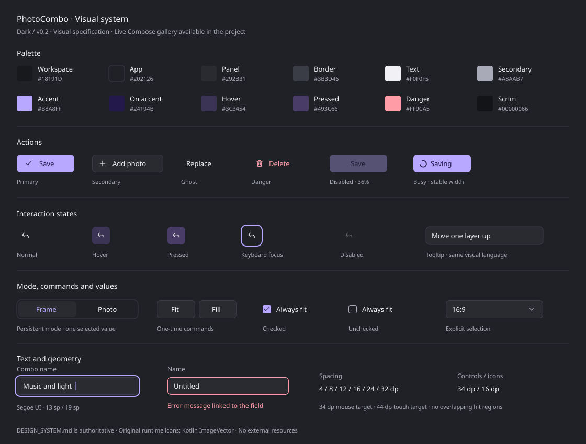

# PhotoCombo Design System

Версия: **0.3** · Статус: **утверждён «Графит · тон» с мягким свечением; миграция экранов впереди**.

Это постоянный источник требований к внешнему виду нового UI PhotoCombo. Числовые
значения ниже задают целевой дизайн, а не описывают уже реализованный интерфейс.
Базовые компоненты реализованы в `ui.common.designsystem`; их настоящая Compose-галерея
доступна отдельной desktop-задачей. Подключение к продуктовым экранам выполняется
отдельно: сначала Combo builder, затем библиотека, списки, просмотр и общие диалоги.
Размещение, запуск и границы проверки: [состояние реализации](DESIGN_SYSTEM_IMPLEMENTATION.md).

Требования владельца: собственные компоненты на низкоуровневых API Compose без
сторонних UI-библиотек; собственные иконки в `ImageVector`; соблюдение направления
зависимостей. Продуктовые правила, хранение данных и геометрия комбо определяются
кодом и соответствующими разделами README, а не этой спецификацией.

## 1. Визуальный ориентир и границы

Ориентир — тёмный вариант «Боковой инспектор»: графитовые панели, более тёмная рабочая
область, светлый нейтральный акцент, небольшие скругления, компактные контролы.
Вариант «Графит · тон» использует тональную заливку фокуса, нижнюю полосу и мягкое
свечение под ней; внешняя прямоугольная рамка вокруг контрола не рисуется.
В узком окне те же инструменты размещаются под холстом. Видимые надписи на первом
этапе остаются английскими, как в приложении.



SVG — иллюстрация спецификации, **не набор runtime-иконок и не реализация компонентов**.
Текст и таблицы этого документа имеют приоритет при расхождении. Все ссылки и
изображения хранятся в репозитории; для работы с документом не нужны материалы чата.

Первый набор содержит одну законченную тёмную палитру. Она включается явно в
мигрировавших экранах независимо от системной темы. Контракт темы допускает другие
палитры, но переключатель тем и новая светлая тема не входят в версию 0.1.
Системная строка заголовка Windows находится вне клиентской области Compose и
оценивается отдельно от компонентов приложения.

## 2. Токены

Значения централизованы в `PcTheme`: экран обращается к роли (`colors.panel`,
`spacing.md`), а не копирует HEX/размер. Цвет фотографии, вычисленный фон комбо и
параметры рамок — данные пользователя, они не заменяются цветами темы.

### 2.1. Цвета Dark

Все цвета sRGB; HEX без суффикса альфы означает непрозрачный цвет.

| Токен | Значение | Назначение |
|---|---|---|
| `colors.app` | `#202126` | Подложка приложения, внутренний трек переключателя |
| `colors.panel` | `#292B31` | Панели, меню, диалоги, выбранная вкладка |
| `colors.workspace` | `#18191D` | Рабочая область вокруг холста |
| `colors.text` | `#F0F0F5` | Основной текст и обычные иконки |
| `colors.textSecondary` | `#A8AAB7` | Подписи, имя файла, пояснения |
| `colors.border` | `#3B3D46` | Разделители и спокойные границы |
| `colors.accent` | `#DCE1E6` | Основная кнопка, выделение, фокус |
| `colors.onAccent` | `#1C2528` | Текст и иконки на акцентной кнопке |
| `colors.hover` | `#35383E` | Подложка наведения нейтрального действия |
| `colors.pressed` | `#41454C` | Подложка нажатия нейтрального действия |
| `colors.focusFill` | `#3A3C41` | Тональная подложка видимого фокуса нейтрального контрола |
| `colors.danger` | `#FF9CA5` | Удаление и ошибка |
| `colors.scrim` | `#00000066` | Затемнение за модальным окном |
| `colors.shadow` | `#00000055` | Тень холста и всплывающих поверхностей |

Акцент обозначает главное действие, выбор и фокус. Обычные кнопки используют
нейтральные поверхности. Ошибка дополняется текстом/иконкой, выбор — формой и semantics.
`border` — декоративный разделитель, а не единственный индикатор фокуса или выбора.

### 2.2. Типографика

Windows-ориентир — **Segoe UI**; контракт `PcTypography` принимает `FontFamily`.
Desktop-адаптер разрешает системный шрифт, общий код имеет `FontFamily.SansSerif`
как fallback. Системные файлы шрифта не копируются в репозиторий. Для визуального
сравнения фиксируется фактически разрешённый шрифт; fallback не считается эталоном.

| Стиль | Размер / высота строки | Вес | Применение |
|---|---|---|---|
| `title` | 14 / 20 sp | 500 | Название документа, заголовок инспектора/диалога |
| `body` | 13 / 19 sp | 400 | Основной текст и поля |
| `control` | 13 / 18 sp | 400 | Подписи кнопок и списков |
| `controlStrong` | 13 / 18 sp | 500 | Основное действие, активная вкладка |
| `label` | 12 / 17 sp | 400 | Название группы и вторичные подписи |
| `caption` | 11 / 16 sp | 400 | Короткая подсказка, статус |

Числа масштаба используют табличные цифры, если шрифт их поддерживает. Имя файла и
название документа могут иметь ellipsis; полное значение доступно в подсказке и
semantics. Названия действий не обрезаются ради сохранения строки.

### 2.3. Геометрия

Размеры задаются в dp, шрифт — в sp. Физические пиксели появляются только при
растеризации; дробный размер учитывает `Density`, масштабирование Windows и fontScale.

| Токены | Значения |
|---|---|
| `spacing.xs / sm / md / lg / xl / xxl` | 4 / 8 / 12 / 16 / 24 / 32 dp |
| `radii.small / control / group / dialog` | 4 / 7 / 9 / 12 dp |
| `sizes.control / iconButton / compactControl` | 34 / 34 / 28 dp |
| `sizes.icon / iconLarge` | 16 / 20 dp |
| `strokes.border / selection / focus` | 1 / 2 / 2 dp |
| `sizes.focusOffset` | 2 dp зарезервированного свободного пространства у контрола; не отступ рамки |
| `focus.gradientHeight / innerAlpha` | 10 dp / 0.14 — внутренний градиент над нижней полосой |
| `focus.haloHeight / haloAlpha` | 4 dp / 0.35 — мягкое затухание под нижней полосой |
| `opacity.disabled` | 0.36 от итогового normal-состояния |
| `motion.feedback / popup` | 120 / 160 ms |

`compactControl` предназначен для строки масштаба, а не для всех кнопок. Минимальная
область нажатия: 34×34 dp для мыши и 44×44 dp для касаний; `PcDensity` выбирается
на уровне хоста. Увеличение hit area учитывается при layout, области соседей не
перекрываются. Высота текстового контрола может расти при увеличении fontScale.

Тени: холст — смещение вниз 5 dp, мягкость 22 dp, `colors.shadow`; меню — 4/18 dp;
диалог — 10/40 dp. Это визуальные параметры, а не номер elevation Material. Реализация
использует поддерживаемую Compose-отрисовку; backend-отличия тени проверяются снимком.

## 3. Состояния и взаимодействие

| Состояние | Внешний вид | Поведение |
|---|---|---|
| Normal | Нейтральный текст; заливка зависит от варианта | Доступное действие |
| Hover | `hover` у нейтральной кнопки | Подсказка через 500 ms; layout неподвижен |
| Pressed | `pressed`; у primary лёгкое затемнение заливки | Один вызов после корректного отпускания |
| Focused | `focusFill`, нижняя полоса 2 dp, внутренний градиент и мягкое свечение снизу | Клавиатурный фокус виден и на выбранном контроле; поле показывает также фокус редактирования мышью |
| Selected | Подложка `panel`, текст `accent`, чёткая выбранная вкладка | Передаётся `selected`/`toggleState` и роль |
| Disabled | Normal с opacity 0.36 | Не вызывает callback, не попадает в Tab-порядок |
| Busy | Индикатор внутри сохранённой ширины кнопки | Повторное действие блокируется, объявляется занятость |
| Error | `danger`, текст причины | Ошибка связана с соответствующим полем |

Приоритет фона: disabled → pressed → visible focus → hover → normal; selected —
независимое состояние. Нижний индикатор фокуса сохраняется при hover/pressed.
Фокус/ошибка не увеличивают размер компонента и область нажатия, не меняют геометрию
или callbacks. Hover/pressed затухают за `motion.feedback`; скейл кнопок и bounce не нужны.
При уменьшенном движении переходы мгновенные. Жесты холста и перенос инспектора
не получают декоративных анимаций, рассинхронизирующих изображение и hit test.

Фокус кнопок, icon button, checkbox, сегментов и select показывается только при
`InputMode.Keyboard`. Фокус после щелчка мышью сохраняет штатную семантику Compose,
но не включает этот декоративный индикатор. Текстовое поле показывает фокус ввода
при любом способе его получения, включая мышь; readOnly сохраняет фокус для выделения.

Нижняя полоса имеет толщину `strokes.focus` (2 dp), находится внутри контура и
обрезается собственной shape контрола. Внутри над ней — линейный градиент `accent`
от 14% внизу до прозрачного на высоте 10 dp. Сразу под полосой — мягкое внешнее
свечение `accent`: максимум 35%, затухание к прозрачному в пределах 4 dp.
Заливка/полоса/внутренний градиент обрезаются shape, нижнее свечение рисуется отдельно.
Свечение не образует контур по остальным сторонам. Радиусы и размеры не меняются.

Primary сохраняет акцентную заливку: нижняя полоса использует тёмный `onAccent`,
свечение под ней — светлый `accent`. Поле с ошибкой сохраняет danger-границу и текст
ошибки; полоса, градиент и свечение используют `danger`, чтобы фокус не маскировал
валидацию. Disabled не показывает фокус. Отмеченный checkbox сохраняет отметку,
выбранный сегмент — выбранное состояние; фокус добавляет самостоятельный индикатор.

Клавиатура: Tab/Shift+Tab перемещают фокус; Enter/Space активируют кнопку/флажок;
стрелки выбирают сегмент или пункт открытого списка; Escape закрывает верхнее меню
или диалог и возвращает фокус инициатору. В текстовом поле пробел вводит символ.
Клавиатурное событие не должно дублировать click, переключатель — вызывать onClick
и onValueChange одновременно. Нажатие с уходом курсора/отменой не активирует действие.

Появление popup занимает `motion.popup`; закрытие и возврат фокуса происходят сразу,
без ожидания декоративного перехода. Всплывающая поверхность не меняет геометрию во
время появления. Busy-кнопка сохраняет размеры даже при подписи из одного символа.

Для enabled-текста целевые отношения контраста — не менее 4.5:1, для непрозрачной
нижней полосы фокуса на соседней поверхности — 3:1. Градиент и свечение являются
дополнением к полосе; их альфа сама по себе не обеспечивает этот контраст.
Проверка проводится по итоговому цвету после альфы.
Один визуальный контрол имеет один семантический интерактивный узел; вложенная
декоративная иконка не создаёт второй фокус. Подсказка не заменяет доступное имя.

## 4. Базовые компоненты

Набор намеренно небольшой. Каждый компонент получает состояние и callback, а не
читает ViewModel, DI или репозиторий. Корневой `modifier` передаётся вызывающим без
потери testTag/semantics/focus. Визуальные состояния не хранят продуктовые данные.

| Компонент | Контракт и назначение |
|---|---|
| `PcTheme` | `colors`, `typography`, `spacing`, `sizes`, `shapes`, `focus`, `motion`, `density` через CompositionLocal |
| `PcText`, `PcSurface`, `PcDivider` | Текст по роли, поверхность и разделитель; без действий приложения |
| `PcIcon` | `ImageVector`, размер, tint, nullable contentDescription; декоративная иконка исключена из semantics |
| `PcButton` | `text`, `onClick`, `modifier`, вариант Primary/Secondary/Ghost/Danger, enabled, busy, необязательная ведущая иконка |
| `PcIconButton` | Иконка, обязательное доступное имя, onClick, enabled; та же политика состояний, подсказка по имени |
| `PcSegmentedControl<T>` | `options`, `value`, `onValueChange`, enabled; один выбранный пункт, роль RadioButton, одинаковая высота сегментов |
| `PcActionGroup` | Layout группы одноразовых действий; не хранит выбранный пункт |
| `PcCheckbox` | `checked`, `onCheckedChange`, `label`, enabled; кликабельны и флажок, и подпись; один callback |
| `PcTextField` | `value`, `onValueChange`, label, enabled/readOnly, error; выделение, курсор и ввод обеспечивает BasicTextField |
| `PcSelect<T>` | `value`, `options`, `onValueChange`, доступное имя; Popup со списком, активным пунктом и возвратом фокуса |
| `PcTooltip` | Текст, инициатор, задержка; показывается при hover и фокусе, не перехватывает основной click |
| `PcDialog` | Заголовок, содержимое и слот действий; блокировка фона, удержание/возврат фокуса, управляемый onDismissRequest |

`PcOption<T>` — стабильное значение, текст и необязательная `ImageVector`. Компонент
работает с `T`, не знает типы конкретной фичи и не сериализует выбор. Списки не
превращаются в «переключить на следующий»: пользователь выбирает значение напрямую.

У сегментов и select список непустой, значения уникальны, выбранное значение
присутствует в списке. Сегменты имеют равную ширину по самому широкому пункту, если
места хватает; иначе текст переносится, высота всех сегментов растёт одинаково.
Select хранит активный пункт по значению, сохраняет его при перестановке options и
возвращается к выбранному значению при его удалении. Меню ограничено окном: целевой
максимум ширины 360 dp (не уже инициатора), высоты 320 dp; длинный список прокручивается.
Диалог имеет максимум 480 dp и внешние отступы 24 dp. Его тело прокручивается,
группа действий переносится и допускает прокрутку при ограниченной высоте. Даже
без доступных действий диалог принимает Escape. `returnFocus` позволяет явно задать
инициатор, когда автоматического восстановления платформенного слоя недостаточно.
`PcIconButton` требует непустое доступное имя. Label и error поля доступны через
semantics ввода; декоративные дубли подписей не создают вторые узлы.

При конечной высоте `PcActionGroup` резервирует внутри viewport 4 dp с каждой стороны
для нижнего свечения фокуса; при неограниченной высоте использует обычный поток без вложенного
scroll viewport. Прокрутка сохраняет доступность команд вместо рисования за границами.

**Режим и команда — разные контракты.** Frame/Photo — постоянный режим и потребитель
`PcSegmentedControl`. Fit/Fill — одноразовые команды в `PcActionGroup`; их не следует
выдавать за сохраняемый режим. Always fit — отдельный `PcCheckbox`. Это также устраняет
неоднозначность Fit/Fill у фото с пропорциями рамки, когда обе команды дают одну картинку.

## 5. Низкоуровневая реализация

Разрешены уже используемые официальные Compose Runtime, UI, Foundation и Animation:
`Canvas`, `DrawScope`, `drawWithCache`/`drawWithContent`, `Layout`/`SubcomposeLayout`,
`Modifier`, `BasicText`, `BasicTextField`, focus, semantics, InteractionSource,
`clickable`/`toggleable`/`selectable`, scrolling и платформенные Popup/Dialog.
Новые сторонние библиотеки оформления, иконок и layout не добавляются.

- Внешний вид компонентов рисуется собственными примитивами и Modifiers. Обёртка
  над Material Button/Checkbox/SegmentedButton/TextField не считается реализацией DS.
- Canvas применяется к фону, контурам, индикаторам и декоративным деталям. Текст,
  редактирование, фокус и доступность сохраняют стандартные механизмы Compose;
  рисование всего экрана одним Canvas недопустимо для интерактивного UI.
- `Layout` измеряет контент, затем применяет min size/отступы. Переданные constraints,
  layoutDirection, density и fontScale учитываются; intrinsic measurement реализуется,
  если его требует публичный контракт. Компонент не предполагает ширину окна builder.
- Ввод кнопок строится на Foundation. Свой pointerInput нужен только для поведения,
  которого нет в примитивах; он не подменяет штатные focus/semantics.
- Immutable-токены и ImageVector переиспользуются. Paths, кисти и измерения не
  пересоздаются в каждом draw. `drawWithCache` инвалидируется при изменении входов;
  `@Stable`/`@Immutable` ставятся только при выполнении их контракта.
- Порядок clip/background/border/focus/content/hit area фиксируется тестами.
  Нижняя полоса и градиент ограничены shape, свечение не обрезается внутренним clip.
  Слоты и внешние Modifiers не могут
  случайно изменить область действия или потерять доступное имя.

Material остаётся в ещё не мигрировавших экранах. Новый набор сам не зависит от
Material-компонентов и не читает MaterialTheme; временный адаптер живёт снаружи DS.

### 5.1. Собственные векторные иконки

Runtime-формат — **Compose `ImageVector`**, построенный в Kotlin через
`ImageVector.Builder`/`path`. Векторы создаются как оригинальные простые пиктограммы;
пакеты Material/Lucide, SVG-парсеры, icon fonts и растровые картинки не используются
как источник новых иконок. SVG в этой папке служит только визуальной документацией.

- Координатная сетка 24×24, безопасное поле 2 единицы; обычный показ 16 dp, крупный 20 dp.
- Базовый stroke 1.75 единицы viewport, круглые окончания/соединения, единый оптический вес.
- Цвет задаётся tint потребителя; disabled-тон также приходит из темы.
- `PcIcons` возвращает кэшированные векторы. Направленные Back/Undo/Redo зеркалируются
  для RTL; знаки +/−, фотография и корзина не зеркалируются без смысловой причины.
- Первая группа: Back, Undo, Redo, Add, Remove, Check, Close, ChevronDown, Photo,
  ReplacePhoto, Delete, LayerUp, LayerDown, WholeCanvas, AspectRatio, Palette, Frame,
  Crop, Info, Warning. Имя описывает назначение, а не источник рисунка.

## 6. Архитектура и размещение

Начальный набор живёт в существующем KMP-модуле, в `commonMain`:

```text
com.combo.ui.common.designsystem/
  tokens/       PcColors, PcTypography, PcSpacing, PcSizes, PcShapes, PcFocus, PcMotion
  theme/        PcTheme, CompositionLocal, выбор плотности
  primitives/   PcText, PcSurface, PcDivider, focus/interaction Modifiers
  icons/        PcIcons и оригинальные ImageVector
  components/   кнопки, сегменты, checkbox, поле, select, tooltip, dialog
```

Направление внутри набора: `tokens ← theme ← primitives ← components`;
`icons` — независимая ветвь, которую используют primitives/components и вызывающий UI.
Токены не импортируют components, primitives не импортируют components, циклов нет.

На уровне приложения это **общий UI-лист**: `feature.* → ui.common.designsystem` и
`ui` навигации → `ui.common.designsystem`. Уже разрешённая связь фич с `ui.common`
не превращает DS в верхний слой навигации. DS не импортирует `feature`, `domain`,
`data`, DI, ViewModel, `core` с моделями приложения или корень `com.combo.ui`.
Названия Combo/Photo/Builder, бизнес-лимиты и события редактирования остаются в фичах.
`core`, `data` и `domain` не получают зависимость на DS.

Платформенный выбор шрифта/плотности передаётся из `desktopMain` адаптером. В общем
наборе запрещены `android.*`, `java.*`, `javax.*`, `org.jetbrains.skia.*`.
Новый Gradle-модуль для первой версии не требуется.

Перед реализацией нужно расширить `ArchitectureRulesTest`: нынешняя проверка
`ui.common` сравнивает имя пакета точно и не покрывает автоматически его подпакеты.
Нужны prefix-правила для всей DS, граф внутренних зависимостей и синтетические
нарушения, доказывающие, что ограничения реально срабатывают. Нельзя ослаблять
существующие правила слоёв ради удобства компонентов.

## 7. Применение к Combo builder

Это композиция фичи, а не знание базовых компонентов о редакторе:

- Заголовок около 57 dp: компактное имя, история, основное Save; настройки холста
  около 51 dp: формат, фон и Add photo. Высота может расти при fontScale.
- Инспектор 240 dp справа при ширине от 760 dp; ниже — контекстная панель под холстом.
  Это целевой вариант макета; текущие 840/264 dp ещё не мигрированы на эту спецификацию.
- Базовые отступы рабочей области: 32 dp в широком и 20 dp в узком окне. Холст
  вписывается в оставшуюся область, а перемещения/зум считаются в единой системе
  координат с hit test и оверлеем. Отступы не записываются в данные комбо.
- Выделение: accent-контур 2 dp, небольшая подпись рамки. Маркеры указывают реальные
  доступные действия; расположение маркера не обещает неподдерживаемый угловой ресайз.
- Без выделения инструменты рамки скрыты. Широкий инспектор можно свернуть,
  сохраняя предсказуемую геометрию при следующем выборе; поведение проверяется
  вместе с жестом, начавшимся до изменения доступной области.
- Строка вида около 42 dp: понятная подсказка, −/проценты/+, Whole canvas. Сброс
  выключен в исходном положении. Управление видом не меняет драфт и Undo.
- Выбор фото, замена, сообщение об ошибке и диалог выхода используют ту же тему.
  Перестройка разметки сохраняет текст, выделение, открытый popup и отметки в диалоге.

Отдельные вызовы `drawItem`, `buildItemFrame`, `drawCombo` и `effectiveFraming`
сохраняют единую точку истины; визуальная миграция не дублирует рендер фотографий.

## 8. Реализация и критерии приёмки

Последовательность: токены/тема и PcIcons → примитивы/кнопки → переключатели и поле →
меню/подсказки/диалог → миграция builder → перенос на остальные экраны отдельными PR.
Первая версия проектирует только перечисленные компоненты; новые сущности добавляются
в документ вместе с реальным потребителем.

Для каждого компонента нужна галерея состояний, использующая его настоящую Compose-
реализацию. Галерея состоит из обычных UI-сцен без репозиториев, сети и ViewModel;
её можно поднимать в `desktopTest` и получать воспроизводимые снимки.

Приёмка первой реализации:

1. Снимки компонентов во всех состояниях и целого builder при 420×700, 800×700,
   1200×760; scale Windows 100% и 150%, fontScale 1.0 и 1.25. Размеры сравниваются
   в одинаковых единицах, различия сглаживания текста отделяются от ошибок геометрии.
2. Для сравнения builder используются одинаковые тестовые фотографии, выбранная
   рамка и параметры вида. Базовый набор снимков не зависит от личной библиотеки.
3. Проверены hover, press/cancel, клавиатура, Tab-порядок, роли/имена, недоступность,
   возврат фокуса, клики по всей области checkbox и устойчивость при ресайзе.
4. Нажатие вызывает ровно один callback; перерисовка сама его не вызывает. Тема,
   плотность и длинные подписи не обрезают контент или нижнее свечение фокуса.
5. Тесты архитектуры и источник-гигиены проходят, сторонних UI-зависимостей нет,
   собственные векторы отображаются в размерах 16/20 dp и в disabled-состоянии.
6. Полный `:composeApp:desktopTest` зелёный; жесты, Undo/Redo, хранение и финализация
   композиции сохраняют поведение. В отчёте отдельно указано, что проверено снимками,
   что автоматическими действиями, а что вручную на работающем приложении.

## 9. Ведение документа

Любое изменение роли цвета, размеров, состояния или публичного контракта меняет
эту спецификацию в том же PR. Версия документа повышается, значимые несовместимости
отмечаются в описании PR. Визуальный лист обновляется при изменении изображённых
токенов/состояний. Статус «реализовано» можно ставить только для поставленного и
проверенного кода, а не по наличию макета.
